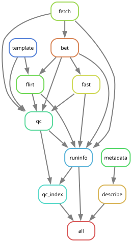
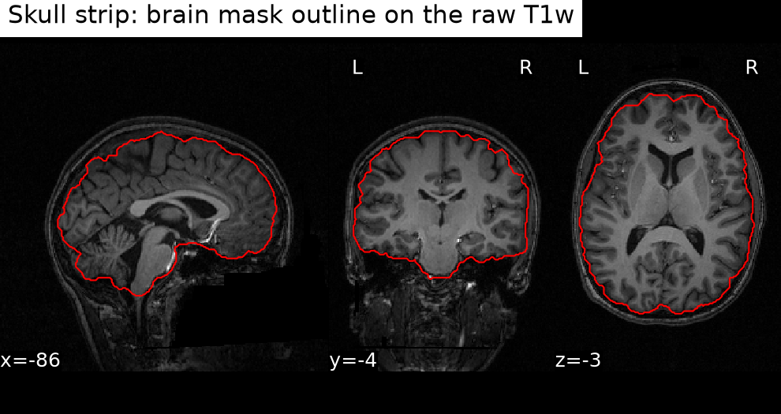
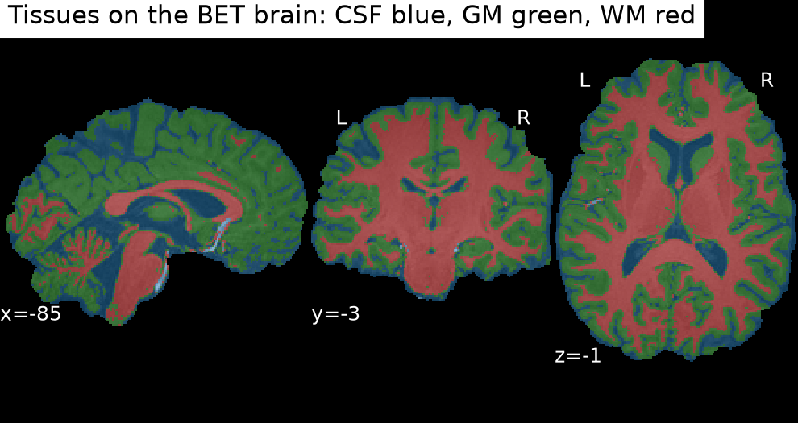
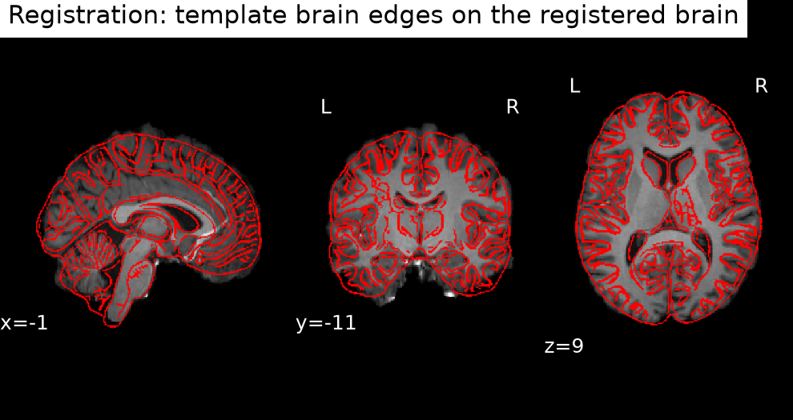

# openneuro-t1-pipeline

[](https://github.com/raihanvaheed/openneuro-t1-pipeline/actions/workflows/ci.yml)

This pipeline downloads public T1-weighted MRI scans from OpenNeuro on AWS S3 (anonymously) and runs three FSL steps on each one: BET skull stripping, FAST tissue segmentation and FLIRT registration to MNI space, all through NiWrap in Docker. The outputs are written as BIDS derivatives, with a quality-check image for every step.

**Status:** v0.1.0, first release.

This is an engineering project: it describes a pipeline and makes no research claims.

## Requirements

- [uv](https://docs.astral.sh/uv/) to manage the Python environment
- [Docker](https://www.docker.com/), which runs the FSL image (it is amd64, so it runs under emulation on Apple Silicon)
- the [AWS CLI](https://aws.amazon.com/cli/); reads are anonymous, so no AWS account or credentials are needed

## Run one subject

```bash
uv sync
uv run openneuro-t1 --subject 01
```

Finished steps are skipped on a rerun; add `--force` to redo them. The first run pulls the FSL Docker image, so it is slow.

`--step` runs a single step. Subject steps (`fetch`, `bet`, `fast`, `flirt`, `qc`, `runinfo`) need `--subject`; dataset steps (`metadata`, `template`, `describe`, `qc_index`) take none:

```bash
uv run openneuro-t1 --subject 01 --step bet
uv run openneuro-t1 --step template
```

## Run the batch

The subjects are listed in `config/config.yaml`. Snakemake runs each step as its own job, four at a time, and keeps going if a job fails. Look at the plan first, then run it:

```bash
uv run snakemake -n
uv run snakemake
```

| Output | Where |
| --- | --- |
| QC index, one page with every subject's three QC images and step timings | `results/qc/index.html` |
| Snakemake report, built after a run with `uv run snakemake --report results/qc/snakemake_report.html` | `results/qc/snakemake_report.html` |
| Provenance: one record per step, merged into one `runinfo.json` per subject | `results/provenance/` |

The steps and what they depend on, generated by `uv run snakemake --rulegraph | dot -Tsvg > docs/rulegraph.svg`:



| Folder | Holds |
| --- | --- |
| `resources/` | downloaded OpenNeuro data, the TemplateFlow cache and the template brain |
| `results/` | the BIDS derivatives dataset: images, QC figures, the QC index and `provenance/` |
| `logs/` | one log per step: its command, stdout and stderr |

All three are regenerable and gitignored. The pipeline is described in [docs/architecture.md](docs/architecture.md).

## What a run produces

The three QC figures of `sub-01`:



Skull strip: the raw T1w in three views, with the outline of the BET brain mask in red.



Tissues: the BET brain with the FAST labels overlaid, CSF in blue, grey matter in green and white matter in red.



Registration: the registered brain with the edges of the MNI152NLin2009cAsym template brain in red.

The figures are for visual review; the pipeline makes no judgement about them.

For each subject the pipeline writes, under `results/`:

- `sub-<id>/anat/sub-<id>_desc-brain_T1w.nii.gz` and `sub-<id>_desc-brain_mask.nii.gz`: the skull-stripped brain and its mask (BET)
- `sub-<id>/anat/sub-<id>_dseg.nii.gz` and `sub-<id>_label-{CSF,GM,WM}_probseg.nii.gz`: the tissue labels and the three tissue maps (FAST)
- `sub-<id>/anat/sub-<id>_space-MNI152NLin2009cAsym_desc-brain_T1w.nii.gz` and `sub-<id>_from-T1w_to-MNI152NLin2009cAsym_mode-image_xfm.mat`: the brain in MNI space and the affine matrix (FLIRT)
- `sub-<id>/figures/`: the three QC figures
- `provenance/sub-<id>/<step>.json` and `provenance/sub-<id>_runinfo.json`: what produced the outputs

## Performance and reproducibility

| Machine | Jobs at a time | Wall time, 10 subjects | FAST per subject |
| --- | --- | --- | --- |
| Apple Silicon Mac, Docker Desktop with 10 CPUs and 8 GB, FSL under amd64 emulation | 4 | 30 min 56 s | 304.0 to 446.9 s |
| AWS EC2 `m7i-flex.large` (2 vCPU, 8 GiB, x86) | 2 | 26 min 6 s | 220.3 to 231.8 s |

The SHA-256 of the uncompressed content of 91 files (the 10 raw scans, the template brain and 80 subject outputs) was identical on both machines: see [docs/ec2.md](docs/ec2.md) for the numbers and how to recompute it, and [docs/fingerprints.txt](docs/fingerprints.txt) for the expected values. They hold for the pinned image digest, `uv.lock` and these ten subjects.

## Running in the cloud

The same workflow ran once on an AWS EC2 machine (`m7i-flex.large`, x86, so no emulation), with no AWS credentials on it because the reads are anonymous. [docs/ec2.md](docs/ec2.md) describes how to repeat the run.

## Known limits

- Registration is affine only.
- BET runs with default settings, and in the QC figures the masks differ most at the base of the skull between subjects. It has not been tuned.
- In the QC figures, the labels of deep grey structures vary between subjects.
- The FSL image is amd64-only. On Apple Silicon it runs under emulation: slower, and with identical outputs in the check above.
- The pipeline has been tested on 10 subjects of `ds000102` only.
- CI checks the code, not the imaging steps.

## Data

The input is OpenNeuro dataset ds000102. Cite it as:

> Kelly AMC, Uddin LQ, Biswal BB, Castellanos FX, Milham MP (2018). Flanker task (event-related). OpenNeuro, dataset ds000102. Originally shared through the OpenfMRI database (accession ds000102). OpenNeuro lists no DOI for this dataset. https://openneuro.org/datasets/ds000102

The dataset is released under the PDDL (Public Domain Dedication and License), as stated in its `dataset_description.json`. No imaging data is stored in this repository.

## Credits

The project structure follows [styx-api/niwrap-workflow-examples](https://github.com/styx-api/niwrap-workflow-examples) and Snakemake's recommended workflow layout.

## License

[MIT](LICENSE)
