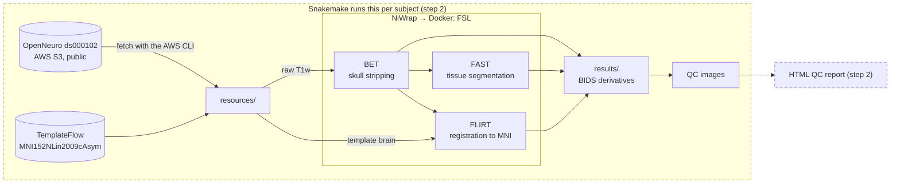

# Architecture

The pipeline reads a public T1-weighted scan from OpenNeuro `ds000102` on AWS S3 (anonymously, with the AWS CLI) and builds a template brain from TemplateFlow `MNI152NLin2009cAsym`; both land in `resources/`. FSL BET strips the skull, then FAST segments tissue and FLIRT registers the brain to the template brain. Each tool runs through NiWrap in a Docker container. Every output is written to `results/` as a BIDS derivatives dataset, and each step gets a QC image. The dashed parts are not built yet: step 2 runs the same functions per subject with Snakemake and adds an HTML QC report.

