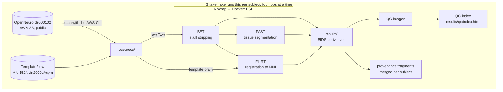

# Architecture

The pipeline reads public T1-weighted scans from OpenNeuro `ds000102` on AWS S3 (anonymously, with the AWS CLI) and builds a template brain from TemplateFlow `MNI152NLin2009cAsym`; both land in `resources/`. FSL BET strips the skull, then FAST segments tissue and FLIRT registers the brain to the template brain. Each tool runs through NiWrap in a Docker container. Every output is written to `results/` as a BIDS derivatives dataset, and each step gets a QC image.

Snakemake runs each step as its own job for every subject, four at a time. Files that every subject shares are made by dataset-level steps that run once (`metadata`, `template`, `describe` and `qc_index`), so parallel jobs never write the same file. Each subject step writes a provenance fragment, and a final step merges a subject's fragments into one `runinfo.json`. The QC index is one HTML page with every subject's QC images and timings.

The graph above is generated from the workflow by `snakemake --rulegraph`; the diagram below shows the data around it.

